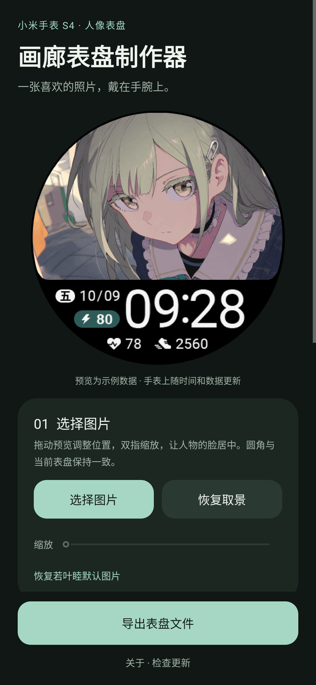
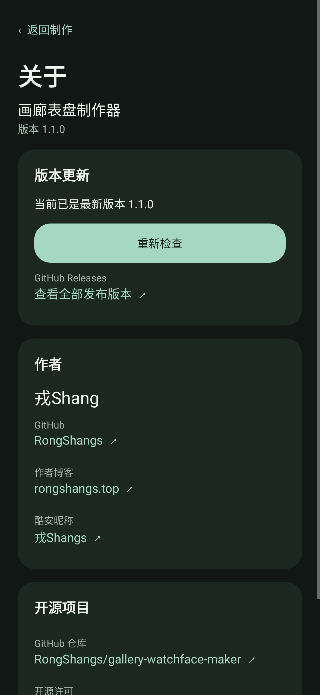

# 画廊表盘制作器

在 Android 手机上选择图片、调整取景和电量颜色，制作小米手表 S4 的人像表盘。

[下载安装包](https://github.com/RongShangs/gallery-watchface-maker/releases/latest) · [更新记录](CHANGELOG.md) · [反馈问题](https://github.com/RongShangs/gallery-watchface-maker/issues)

**Android 9 及以上 · 包名 `top.rongshangs.watchface` · 当前版本 1.1.0**

## 功能

- 使用系统文件选择器选图，在圆形预览中拖动、双指缩放或用滑条调整取景。
- 修改电量胶囊颜色，支持预设、自定义 HEX 颜色和图片配色提取。
- 根据电量背景的明暗自动切换数字和闪电图标的颜色。
- 使用表盘原生字体、坐标和动态居中布局进行预览与导出。
- 保存 `.bin` 表盘文件、导出预览 PNG、自动保存本地草稿。
- 关于页提供作者主页、博客、酷安和本仓库入口，并检查最新 GitHub Release。

## 界面

<p>
  
  
</p>

界面截图由 Android 原生图形测试环境渲染。

## 使用

1. 从 [Releases](https://github.com/RongShangs/gallery-watchface-maker/releases) 下载并安装 APK。
2. 点「选择图片」，调整位置和缩放，使人物的脸位于合适的位置。
3. 设置「电量区域颜色」，需要时修改表盘名称。
4. 点「导出表盘文件」，通过系统文件窗口保存 `.bin`。
5. 使用你平时安装小米手表 S4 表盘的工具导入该文件。

应用负责制作文件，不连接或刷入手表。预览中的时间、日期、心率、步数和电量是示例，安装到手表后使用实际数据。1.1.0 与原 1.0.0 保持相同包名和签名，可覆盖安装并保留草稿。

## 关于与更新

主页面底部点「关于 · 检查更新」。进入关于页会查询本仓库最新的正式 Release，也可以手动重新检查。发现更高版本时显示更新说明和 APK 下载入口，下载由浏览器处理。没有正式版本、网络失败、查询频率受限或未附加 APK 时，会显示对应提示或提供发布页面入口。

更新接口为公开的 GitHub Releases API，不需要登录或访问令牌。后续正式版本请使用 `v主版本.次版本.修订号` 标签，并在 Release 中附加签名 APK，例如 `GalleryWatchfaceMaker-v1.2.0.apk`。草稿和预发布版不作为正式更新提示。

## 隐私与权限

图片、颜色和取景设置保存在手机本地。应用不上传图片、不申请相册读取权限，也不包含统计 SDK。选图和保存均通过系统文件选择器完成。

应用声明 `INTERNET` 权限，仅在关于页检查版本时请求 GitHub 的公开版本信息。打开作者链接、仓库或下载链接时交由系统浏览器处理。

## 表盘模板

内置若叶睦示例表盘，分辨率 466×466。顶部照片使用连续曲线衔接圆形外缘与底部边界；时间与左侧日期、电量区域协调排布。电量胶囊为 84×32、靠右对齐、无百分号；闪电与数字的可见高度对齐。底部数据和电量使用原生布局，随数字位数变化居中。息屏显示保留模板原有行为。

每次导出均从固定模板重建，压缩大小随图片内容变化，不会在上次文件中累计追加资源。图像使用 8 倍超采样（低内存时 4 倍），再转换为原生 256 色格式，可能出现轻微色阶变化。

## 构建

环境：JDK 17、Android SDK 35、Gradle 9.3.1、Android Gradle Plugin 9.1.0。配置 `ANDROID_HOME`，或在本机 `local.properties` 中指定 SDK 路径。

```shell
# Windows
gradlew.bat :app:assembleDebug
gradlew.bat :app:testDebugUnitTest :app:lintRelease

# Linux / macOS
chmod +x gradlew
./gradlew :app:assembleDebug
./gradlew :app:testDebugUnitTest :app:lintRelease
```

发布版需要项目根目录的 `signing.properties`：

```properties
storeFile=.signing/watchface.jks
storePassword=your_password
keyAlias=watchface
keyPassword=your_password
```

```shell
./gradlew :app:assembleRelease
```

官方发布包使用固定签名，签名私钥、本机路径和构建缓存不包含在仓库中。配置自己的签名后可以构建自己的发布版。

## 验证

12 项自动化测试覆盖表盘压缩与解码、资源保留、照片与颜色导出、数字位数动态居中、取景边界、草稿恢复、文件选择与保存、关于入口与作者链接、版本比较、更新失败和下载回退。

另使用独立桌面解码器与原生 ARM/LVGL 检查表盘资源及布局。发布 APK 已做签名校验；尚未进行真实手机、手表的安装和同步测试。

## 作者

- 作者：**戎Shang**
- GitHub：**RongShangs** · [主页](https://github.com/RongShangs)
- 作者博客：[rongshangs.top](https://rongshangs.top)
- 酷安昵称：**戎Shangs** · [主页](https://www.coolapk.com/u/3261403)

## 许可

Copyright © 2026 戎Shang / RongShangs。程序代码按 **GPL-3.0-or-later** 开源，见 [LICENSE](LICENSE)。格式参考及示例素材说明见 [THIRD_PARTY_NOTICES.md](THIRD_PARTY_NOTICES.md)。
